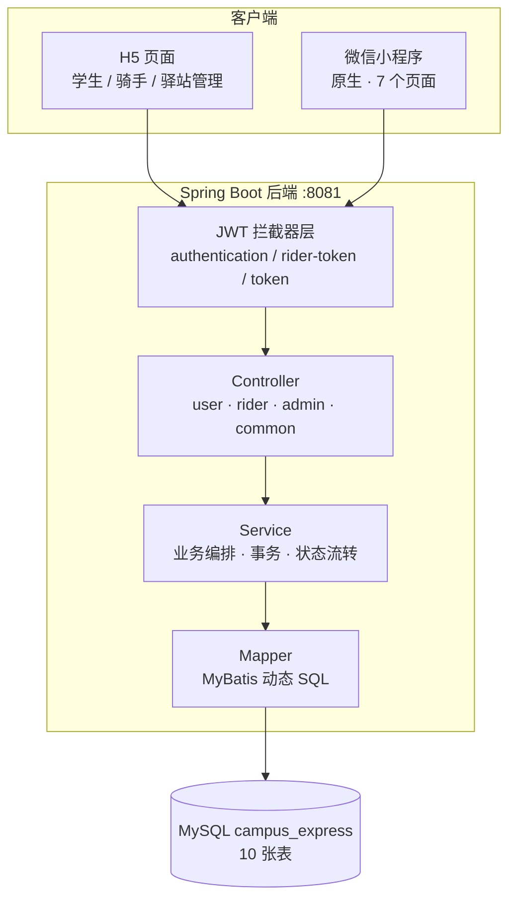
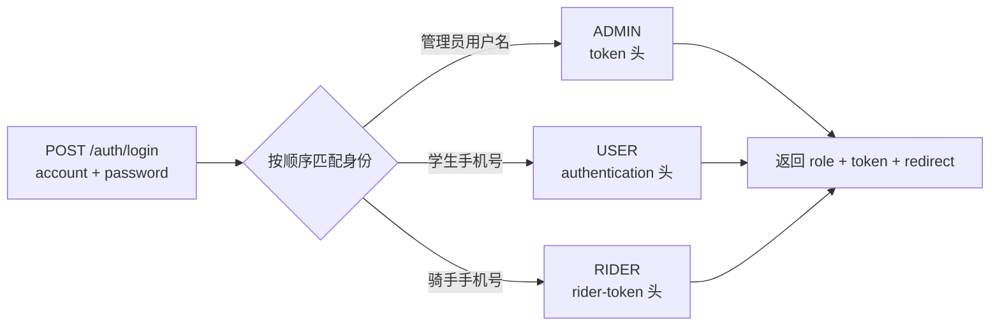
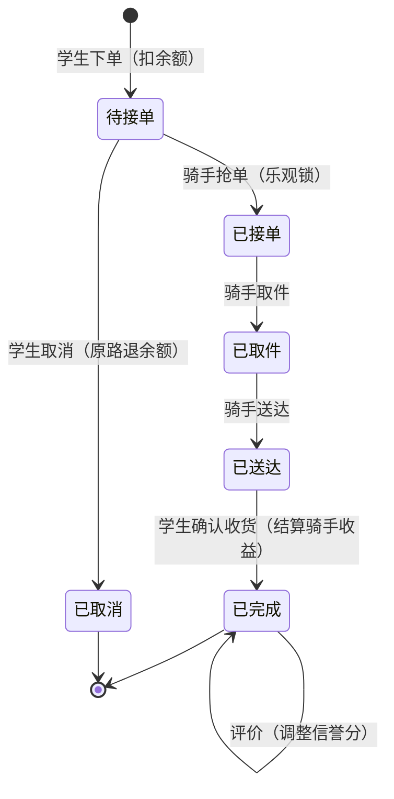

# campus-express · 校园快递代取与驿站管理系统

> 本科毕业设计项目。面向校园场景的快递代取与驿站管理平台，包含**学生端 / 骑手端 / 驿站管理端**三套角色，一套后端 + H5 三页 + 原生微信小程序，打通「驿站入库 → 学生下单 → 骑手抢单取件 → 送达 → 确认收货结算 → 评价」的完整业务闭环。

**技术栈**：Spring Boot 2.7.3 · MyBatis · MySQL · Redis · JWT · 原生微信小程序
**规模**：10 张数据表 · 84 个 Java 类 · 40+ REST 接口 · 三端角色隔离

> 说明：因学校毕业设计保密要求，本仓库仅公开设计文档与截图，**源码未公开**。如需查看代码实现或现场运行演示，可在面试时提供。

---

## 为什么做这个

校园快递的最后 100 米是个高频痛点：驿站爆仓、学生排长队、大件搬不动。这个系统把流程拆成三条角色链路——驿站负责入库上架，学生随时申请代取并按体积付费，骑手抢单赚取收益，评价体系约束服务质量。核心难点不在 CRUD，而在**三套身份的鉴权隔离**、**余额与订单的并发安全**、**多状态流转的一致性**。

## 系统架构

## 功能

**学生端**
- 手机号注册登录，查看/修改个人资料
- 包裹列表（按「未到站 / 已到站 / 滞留」筛选）、包裹详情
- 自助录入快递单号：快递还没到驿站时先报单号，驿站确认到站后自动生成取件码
- 申请代取：选收货地址、填小费与备注，按「基础价 + 体积附加 + 小费」计费，下单即扣余额
- 订单管理：取消（退款）、确认收货（结算骑手收益）、评价（影响骑手信誉分）
- 收货地址增删改查、设置默认地址
- 查看驿站公告

**骑手端**
- 登录、查看个人资料与审核状态
- 上线 / 下线切换
- 抢单大厅、我的订单、接单 / 取件 / 送达
- 收益统计：今日收益、累计收益、待完成单数、平均单笔收益

**驿站管理端**
- 数据看板：今日订单数、今日成交额、今日新增用户、在库 / 滞留包裹数、待接单 / 配送中订单数、骑手总数，以及 6 张统计图表
- 包裹管理：入库（自动绑定用户、生成 6 位取件码、按占用率分配货架）、出库、滞留扫描
- 货架管理：新增货架、查看占用情况
- 订单管理：分页查询、查看详情
- 学生管理：分页查询、启用 / 禁用
- 骑手管理：列表、审核、禁用
- 公告管理：增删改查

## 核心设计

### 1. 三身份统一鉴权

三个角色的 token 头名、密钥、claims 各不相同，但登录入口只有一个：

- 匹配优先级为「管理员用户名 → 学生手机号 → 骑手手机号」，**命中身份后密码错误直接抛错，不再继续尝试**，避免用错误密码撞到其他身份
- 抽象 `AbstractJwtInterceptor` 模板方法，派生出三套拦截器子类，只覆写取 header 名、取密钥、取 claims 三个钩子
- 统一在 `afterCompletion` 清理 `ThreadLocal`，规避线程复用导致的身份串号
- 各端页面与小程序按 `role` 自动切换请求头，401 时清 token 并跳回登录页

### 2. 并发安全

代取下单涉及余额扣减和包裹占用，两处都做了防护：

| 场景 | 方案 |
|---|---|
| 余额扣减 | `UPDATE user SET balance = balance - ? WHERE id = ? AND balance >= ?`，返回 0 行即余额不足，从数据层杜绝超扣 |
| 重复下单 | 下单前对包裹记录加行锁（`SELECT ... FOR UPDATE`），同一包裹不允许并发的进行中订单 |
| 骑手抢单 | `UPDATE pickup_order SET rider_id = ?, status = 1 WHERE id = ? AND status = 0`，返回 0 行即提示「手慢了」 |
| 状态重复流转 | 统一走 `transitStatus(id, from, to)`，SQL 带 `WHERE status = from`，返回 0 行即视为非法操作 |

### 3. 订单状态机

所有状态值收敛在 `StatusConstant` 单一来源：

| 对象 | 状态值 |
|---|---|
| 包裹 | 0 未到站 · 1 已到站 · 2 已出库 · 3 配送中 · 4 已签收 · 5 滞留 |
| 代取订单 | 0 待接单 · 1 已接单 · 2 已取件 · 3 已送达 · 4 已完成 · 5 已取消 |
| 骑手 | 审核 0 待审 / 1 通过 / 2 拒绝；在线 0 离线 / 1 在线 |

### 4. 计费与信誉分

- 代取费用 = 基础价 2 元 + 体积附加（小 0 / 中 1 / 大 3）+ 学生填写的小费
- 信誉分 0~100，评价 5 星 +1、4 星不变、3 星及以下 -2，SQL 用 `GREATEST/LEAST` 锁定区间，避免越界

### 5. 看板数据聚合

管理端看板的 6 组指标由**单个接口**一次聚合返回，避免前端多次往返：

- 今日订单数 / 成交额 / 新增用户
- 在库与滞留包裹数、待接单与配送中订单数、骑手总数
- 近 7 天订单量趋势、近 7 天成交额趋势
- 订单状态分布、包裹状态分布
- 快递公司 TOP5、骑手接单排行 TOP5

其中分组统计通过 `countGroupByStatus()`、`riderRank(limit)`、`expressTop(stationId, limit)` 等聚合查询完成，动态条件用 `<script>` 标签实现，避免 XML 里出现大量重复 SQL。

## 数据库设计（10 张表）

| 表 | 说明 |
|---|---|
| `user` | 学生用户，含余额、学号、openid（预留）、账号状态 |
| `rider` | 骑手，含审核状态、在线状态、信誉分、累计收益 |
| `admin` | 管理员，区分系统管理员（不限驿站）与驿站管理员（限本驿站） |
| `station` | 驿站，含地址、营业时间、经纬度 |
| `shelf` | 货架，含容量与已用数量 |
| `parcel` | 包裹，含运单号、快递公司、体积、取件码、货架位、状态 |
| `pickup_order` | 代取订单，含费用构成、接单骑手、状态流转时间 |
| `address` | 学生收货地址，含默认地址标识 |
| `review` | 评价，含星级、内容、评价时间 |
| `announcement` | 驿站公告 |

详见 [docs/数据库设计.md](docs/数据库设计.md)

## 接口清单

40+ REST 接口，按角色分组，全部带 JWT 鉴权（登录/注册/驿站列表除外）。完整列表见 [docs/接口清单.md](docs/接口清单.md)

| 分组 | 前缀 | 主要接口 |
|---|---|---|
| 公共 | `/auth` | 统一登录（自动识别身份） |
| 学生端 | `/user` | 登录注册、个人信息、包裹、代取订单、地址、公告 |
| 骑手端 | `/rider` | 登录、上下线、抢单大厅、接单取件送达、收益统计 |
| 管理端 | `/admin` | 看板、包裹出入库、货架、订单、学生、骑手审核、公告 |

## 界面预览

**学生端**

| 我的包裹 | 代取订单 |
|:---:|:---:|
|  |  |
| 包裹列表，已到站的显示取件码与货架位 | 订单列表，区分进行中与已完成 |

| 收货地址 | 下单申请 |
|:---:|:---:|
|  |  |
| 地址增删改查与默认地址 | 选择地址、填写小费与备注，按体积计费 |

**骑手端**

| 抢单大厅 | 收益统计 |
|:---:|:---:|
|  |  |
| 本驿站待接单列表，接单走乐观锁 | 今日收益、累计收益、待完成单数 |

**驿站管理端**

| 数据看板 |
|:---:|
|  |
| 7 天订单趋势、成交额趋势、订单/包裹状态分布、快递公司 TOP5、骑手排行，单接口聚合 |

| 包裹入库 | 订单管理 |
|:---:|:---:|
|  |  |
| 入库自动生成 6 位取件码并分配货架 | 分页查询与订单详情 |

**微信小程序**

| 学生端首页 | 骑手工作台 |
|:---:|:---:|
|  |  |
| 原生小程序，tabBar 四页 | 上线接单、抢单、送达独立工作台 |

**微信小程序**

| 学生端首页 | 骑手工作台 |
|:---:|:---:|
|  |  |
| 原生小程序，tabBar 四页 | 上线接单、抢单、送达独立工作台 |

## 小程序端

原生微信小程序（非 uni-app 编译产物），7 个页面，微信开发者工具直接打开即可运行：

- 页面：登录、我的包裹、我的订单、收货地址、个人中心、骑手工作台、驿站管理台
- tabBar 四页：包裹 / 订单 / 地址 / 我的
- `utils/request.js` 统一封装请求：按 `role` 自动切换请求头，401 自动跳登录页，业务错误统一 toast

## 后续规划

- 接入微信小程序登录（`code` 换 `openid`），当前为学生手机号 + 密码
- 骑手端支持自助注册与实名信息提交，当前骑手账号由驿站后台创建
- 订单超时未接单自动取消并退款（配置项已定义，定时任务待接入）

## 说明

- 本项目为个人毕业设计，2026.10 起独立设计与开发
- 后端主线为 Java / Spring Boot；页面层（小程序 / H5）借助 AI 编程工具产出，本人负责接口设计、数据结构定义、联调与验收
- 源码与数据库脚本因保密要求未公开，可面谈演示
