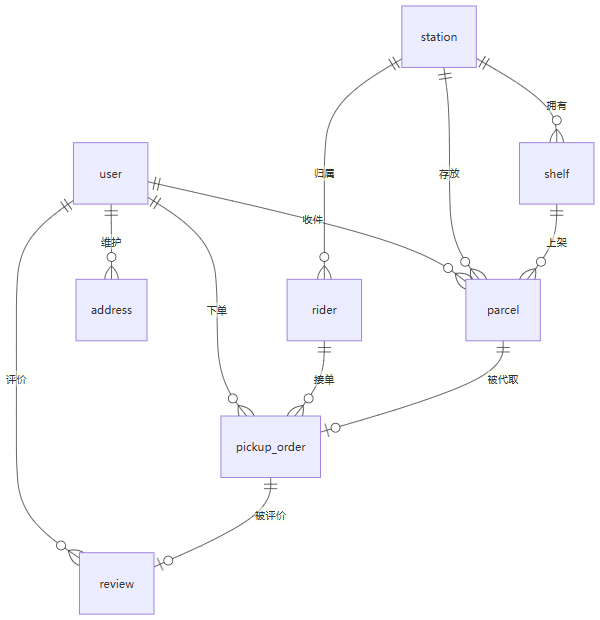

# 数据库设计

MySQL 8.0，库名 `campus_express`，字符集 `utf8mb4`。共 10 张表。

## 实体关系

## 表说明

### user · 学生用户

| 字段 | 类型 | 说明 |
|---|---|---|
| id | BIGINT | 主键 |
| openid | VARCHAR(64) | 微信 openid（预留，唯一索引） |
| student_no | VARCHAR(32) | 学号 |
| nickname / avatar / gender | — | 昵称、头像、性别 |
| phone | VARCHAR(20) | 手机号（登录账号，索引） |
| password | VARCHAR(64) | 密码（MD5） |
| balance | DECIMAL(10,2) | 账户余额，代取下单时扣减 |
| status | TINYINT | 0 禁用 / 1 正常 |

### rider · 骑手（代取员）

| 字段 | 类型 | 说明 |
|---|---|---|
| id | BIGINT | 主键 |
| name / phone / password | — | 姓名、手机号（登录账号，唯一）、密码 |
| id_card | VARCHAR(20) | 身份证号 |
| station_id | BIGINT | 所属驿站（索引） |
| status | TINYINT | 审核状态 0 待审核 / 1 正常 / 2 禁用 |
| work_status | TINYINT | 接单状态 0 离线 / 1 在线 |
| credit_score | INT | 信誉分，默认 100，评价动态调整 |
| total_orders / total_income | — | 累计完成单数、累计收益 |

### station · 驿站

| 字段 | 说明 |
|---|---|
| name / code / address | 驿站名称、编码（唯一）、详细地址 |
| contact_name / contact_phone | 联系人、联系电话 |
| business_hours | 营业时间 |
| longitude / latitude | 经纬度（DECIMAL(10,6)） |
| status | 0 停用 / 1 营业 |

### shelf · 货架

| 字段 | 说明 |
|---|---|
| station_id | 所属驿站 |
| code | 货架编号 |
| capacity | 容量 |
| used_count | 已用数量，包裹入库 +1、出库 -1 |

### parcel · 包裹

| 字段 | 类型 | 说明 |
|---|---|---|
| tracking_no | VARCHAR(64) | 快递运单号（唯一索引） |
| station_id / shelf_id | BIGINT | 所在驿站、货架 |
| user_id | BIGINT | 收件学生（索引） |
| express_company | VARCHAR(32) | 快递公司 |
| receiver_name / receiver_phone | — | 收件人姓名、手机号（入库时按手机号自动绑定用户） |
| sender_name / weight | — | 寄件人、重量 |
| size_type | TINYINT | 体积 1 小件 / 2 中件 / 3 大件，决定体积附加费 |
| pickup_code | VARCHAR(16) | 取件码，入库时生成 6 位（索引） |
| status | TINYINT | 0 未到站 / 1 已到站 / 2 已出库 / 3 配送中 / 4 已签收 / 5 滞留 |
| in_time / out_time | DATETIME | 入库、出库时间 |
| overdue | TINYINT | 是否滞留 0 否 / 1 是 |

联合索引 `idx_station_status (station_id, status)` 支撑驿站维度的状态统计。

### pickup_order · 代取订单

| 字段 | 类型 | 说明 |
|---|---|---|
| order_no | VARCHAR(32) | 订单号（唯一索引） |
| user_id / rider_id | BIGINT | 下单学生、接单骑手（各自索引） |
| station_id / parcel_id / address_id | BIGINT | 取件驿站、关联包裹、送达地址 |
| deliver_address | VARCHAR(255) | 送达地址快照（地址被修改或删除后仍可追溯） |
| expect_time | DATETIME | 期望送达时间 |
| tip | DECIMAL(8,2) | 小费 |
| amount | DECIMAL(8,2) | 代取费用合计 = 基础价 2 + 体积附加 + 小费 |
| status | TINYINT | 0 待接单 / 1 已接单 / 2 已取件 / 3 已送达 / 4 已完成 / 5 已取消 |
| cancel_reason | VARCHAR(255) | 取消原因 |
| finish_time | DATETIME | 完成时间 |

索引 `idx_status` 支撑抢单大厅查询，`idx_create_time` 支撑趋势统计。

### address · 收货地址

| 字段 | 说明 |
|---|---|
| user_id | 所属用户（索引） |
| contact_name / contact_phone | 联系人、联系电话 |
| building / room / detail | 宿舍楼、房间号、详细地址 |
| is_default | 是否默认 0 否 / 1 是 |

### admin · 管理员

| 字段 | 说明 |
|---|---|
| username / password | 登录账号（唯一）、密码 |
| name / phone | 姓名、手机号 |
| station_id | 所属驿站；系统管理员为空表示不限驿站 |
| role | 1 驿站管理员 / 2 系统管理员 |

### review · 评价

| 字段 | 说明 |
|---|---|
| order_id | 关联订单 |
| user_id / rider_id | 评价人、被评价骑手 |
| score | 星级 1~5 |
| content | 评价内容 |

信誉分更新规则：5 星 +1、4 星不变、3 星及以下 -2，SQL 用 `GREATEST(0, LEAST(100, credit_score + ?))` 锁定 0~100。

### announcement · 公告

| 字段 | 说明 |
|---|---|
| station_id | 所属驿站 |
| title / content | 标题、正文 |
| status | 0 隐藏 / 1 显示 |

## 设计要点

1. **状态值单一来源**：所有状态常量收敛在 `StatusConstant`，避免魔法数字散落各处。
2. **地址快照**：`pickup_order.deliver_address` 冗余存储下单时的地址文本，地址被修改或删除后历史订单仍可追溯。
3. **索引按查询场景设计**：`parcel` 建 `(station_id, status)` 联合索引服务驿站统计，`pickup_order` 单独建 `status` 与 `create_time` 索引分别服务抢单与趋势图。
4. **金额统一 DECIMAL**：余额、小费、费用均用 `DECIMAL(10,2)` / `DECIMAL(8,2)`，不用浮点。
5. **软状态而非硬删除**：用户、骑手、包裹都通过 `status` 字段控制可用性，不物理删除，保留历史数据完整性。
